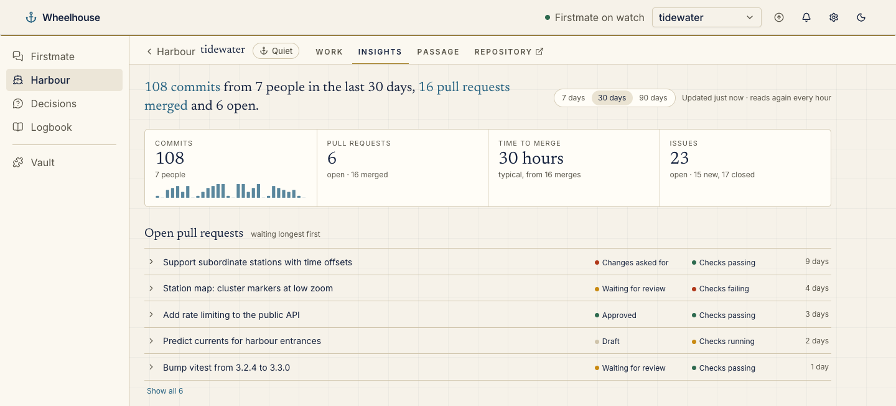
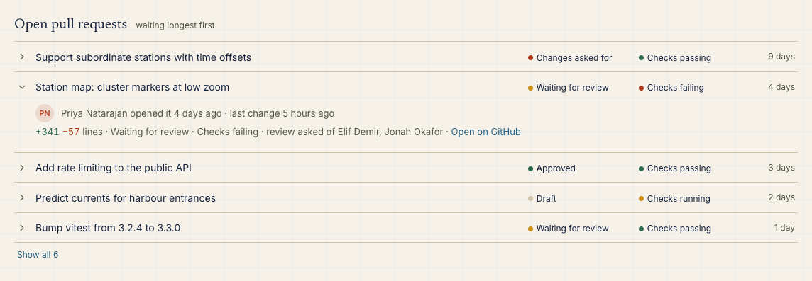
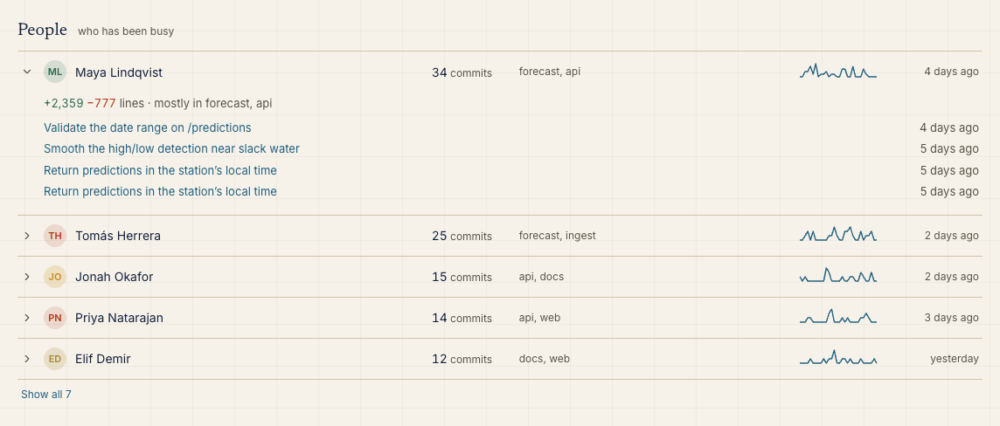
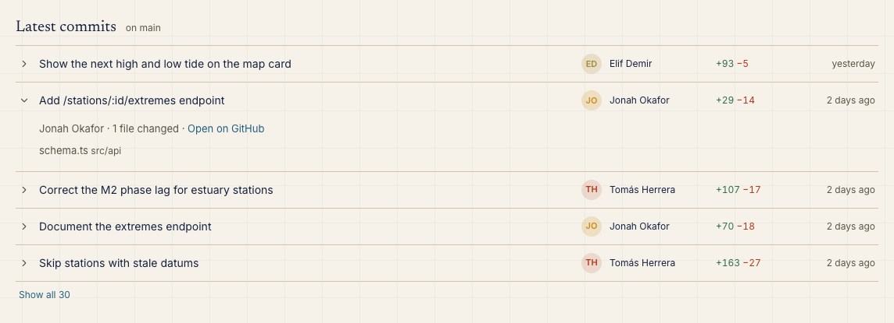
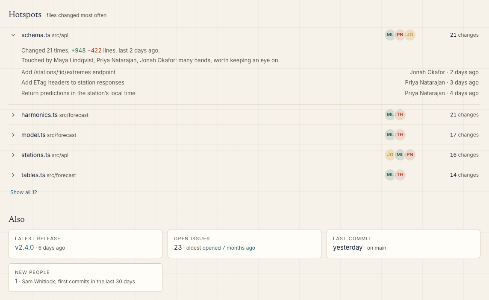

# git-insights-wheelhouse

A [Wheelhouse](https://github.com/chrisjowen/wheelhouse) plugin that adds a **Git insights** page to Wheelhouse's left-hand menu, built from each project clone's git history and, when the clone's `origin` is on GitHub, from GitHub. It shows the figures across all your projects, with a link from each project to its own insights: who is working on it, its latest commits, the files that change most, open pull requests and a few figures. The data is read again every hour.



_The screenshots show a made-up demo project._

## Install

```sh
wheelhouse plugin install chrisjowen/git-insights-wheelhouse
```

Or use **Settings → Plugins → Install plugin** with `chrisjowen/git-insights-wheelhouse`. Installing shows what the plugin adds, asks for its settings (Enter takes each default) and restarts Wheelhouse to load it.

## Turn it on

The plugin is off until you turn it on. Go to **Settings → Plugins → Git insights** and turn it on for every project, or only for the projects you choose. The menu then has a **Git insights** item, after Logbook, that opens the page at `/plugins/git-insights/insights`. It covers the projects the plugin is on for.

## What it shows

The page opens on a period (30 days unless you change the setting) and has a **7 / 30 / 90 days** switch, which the page keeps as you move between projects.

### Every project

The page opens on all the projects together:

- **A summary sentence**, such as "212 commits from 9 people across 4 projects in the last 30 days, 25 pull requests merged and 8 open". Someone who commits to several projects counts once.
- **When it was read**: how old the oldest project's figures are.
- **Figures across the projects**: commits, with a small chart of commits per day (per week over 90 days); open pull requests and how many were merged, and open issues with how many were opened and closed, from the projects on GitHub; and lines added and removed. Without any project on GitHub, files changed takes the place of pull requests and issues.
- **Projects**: a row for each, busiest first, with its commits, people and open pull requests in the period and when it last had a commit. Each row is a link to that project's own insights, at `/plugins/git-insights/insights#project=<project>`; **All projects** goes back. A project that couldn't be read says why.

### One project

A project's own insights, from top to bottom:

- **A summary sentence**, such as "142 commits from 6 people in the last 30 days, 18 pull requests merged and 5 open".
- **When it was read**, such as "Updated 23 minutes ago · reads again every hour".
- **Four figures**:
  - commits, with a small chart of commits per day (per week over 90 days);
  - open pull requests and how many were merged;
  - the typical (median) time from opening a pull request to merging it;
  - open issues, with how many were opened and closed in the period.
- **Open pull requests**, waiting longest first, each with its review state (waiting for review, changes asked for, approved, draft) and its checks (passing, failing, running).
- **People**: who committed in the period, how many commits each made, the parts of the repository they worked in, a small activity line and when they last committed.
- **Latest commits** on the default branch, each with its author, size and age.
- **Hotspots**: the files changed most often in the period, with who changes them.
- **Also**: the latest release, open issues and when the oldest was opened, the last commit, and anyone whose first commit falls in the period.

Every row opens in place for more:

- a pull request's author, size, reviewers and a link to it;
- a person's lines changed and recent commits;
- a commit's files;
- a hotspot's changes and the commits that touched it.









Five rows show until you click **Show all**. The page follows Wheelhouse's light and dark themes.

When a clone has no GitHub remote, its insights say so plainly. They then show what the clone alone can tell: files changed, lines and the busiest day. When GitHub can't be read (for example `gh` isn't signed in, or GitHub is slow), they say why and still show the history. If GitHub was read successfully before, they keep that data and mark it as older.

## How it stays fresh

Reading a busy repository takes a second or two, so the plugin never reads on every page view. It keeps one snapshot per project, and reads again only once the snapshot is older than the refresh interval (60 minutes by default). Wheelhouse serves the last snapshot while a new read runs, so the page doesn't wait.

Wheelhouse asks plugins for data only when a page needs it. So the projects are read again the next time someone opens the page, and the page always says how old its figures are. Wheelhouse gives the plugin about ten seconds an ask, so it reads a few projects at a time and leaves any it has no time for to the next ask, a minute later; until then such a project shows its last figures, or says it hasn't been read yet. If a read fails, the page keeps showing that project's last snapshot, says the read failed, and tries again a few minutes later.

With many busy projects, the page can grow past what Wheelhouse hands a plugin's page. The largest projects' insights then leave out the recent commits and files their rows open to, and say so; past that, a project's own insights are left out, while its row and the figures across projects stay.

The page has no "Refresh now" button: Wheelhouse doesn't yet let a plugin's page ask for its data to be read again. Lowering **Read again every** makes the data fresher.

## Settings

Change these on the plugin's page in **Settings → Plugins**, or under `plugins["git-insights"].settings` in Wheelhouse's `plugins.json`. They apply without a restart.

| Setting                    | Key              | Default    | What it does                                                                                                                                             |
| -------------------------- | ---------------- | ---------- | -------------------------------------------------------------------------------------------------------------------------------------------------------- |
| Read again every (minutes) | `refreshMinutes` | `60`       | How old the figures may get before the plugin reads again; at least 5, at most 1440.                                                                     |
| Period shown first         | `defaultDays`    | `30`       | How far back people, hotspots and the figures look when the page opens (`7`, `30` or `90`); the page can switch.                                         |
| Files left out of hotspots | `hotspotIgnore`  | lock files | File names (`*` matches any part of a name), paths, or folders ending in `/`, such as `dist/` or `*.min.js`.                                             |
| Count bots                 | `includeBots`    | `true`     | Whether bots such as Dependabot count in commits, contributors and the open pull request list. Merged pull request and issue counts always include them. |

## What it reads

The plugin is read-only: it changes nothing in the clone or on GitHub. Every command runs through Wheelhouse's plugin context (an argument list with no shell, a minimal environment, and bounded time and output), in the project's clone:

- `git symbolic-ref` and `git remote get-url origin`, to find the default branch and the GitHub repository;
- `git log --numstat` for the last 90 days of the default branch (at most 5000 commits; merge commits are left out), to get who, when, the subject and the files and line counts each commit changed;
- `git log -1`, for the date of the last commit;
- `git shortlog -s`, to tell who committed before the period began;
- `gh api graphql`, one read-only query when `origin` is on GitHub. It reads the open pull requests (title, author, dates, size, review decision, requested reviewers and checks state), counts of merged pull requests and of issues opened and closed, the open issue count and the oldest open issue, and the latest releases. It never reads issue or pull request bodies.

It uses the `gh` you are signed in with (`gh auth login`); nothing else is needed. The snapshot is kept in Wheelhouse's memory only, so it is read afresh after Wheelhouse restarts.

## Development

```sh
npm install
npm run lint   # eslint and prettier
npm test       # node --test
```

The plugin has no runtime dependencies and no build step. Wheelhouse imports `wheelhouse/server/index.js` and serves `wheelhouse/ui/index.js` to the page as they are. Development dependencies are used only for linting and tests.

- `.wheelhouse-plugin/plugin.json`: the manifest.
- `wheelhouse/server/collect.js`: reads git and GitHub and counts.
- `wheelhouse/server/overview.js`: each project's row, the figures across projects, and keeping the page's data within Wheelhouse's size limit.
- `wheelhouse/server/index.js`: the provider and its snapshot store.
- `wheelhouse/ui/index.js`: the `git-insights-page` element.
- `wheelhouse/icon.svg`: the page's icon in the menu.

## Licence

MIT
